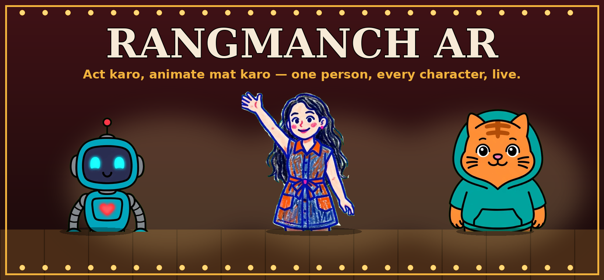
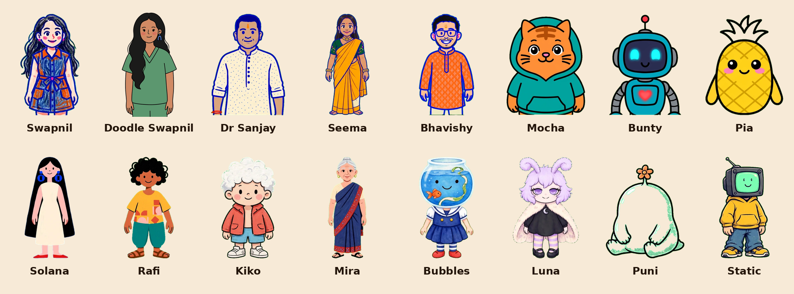
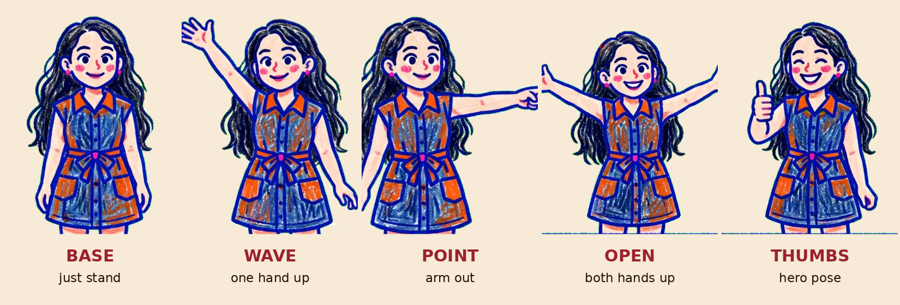
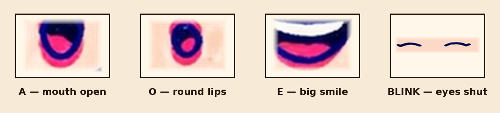

<p align="center">
  
</p>

<p align="center">
  
  
  
  
  
</p>

# Rangmanch AR 🎭

**Every AI tool in this hackathon asks you to type. Rangmanch asks you to *act*.**

Stand in front of your phone. You **become** the lead actor: the character
stands where you stand, leans when you lean — and performs with you. Raise a
hand and it waves; point, and it points; throw both arms wide, and it throws
its arms wide. Those are not tricks: every character ships as a set of complete
authored drawings (base, wave, point, open, thumbs-up) drawn on one canvas, and
a gesture classifier reads your skeleton and performs the matching drawing —
while your **face** drives the lead's mouth, laugh and blinks on every pose,
and your **hands** conduct two full-size co-actors on the stage floor beside
you. Hit record, perform the scene in your own voice, download the cartoon film.

*(Why drawings instead of a cut-up puppet? Because that is how every shipped
avatar system works — Live2D, PNGTubers, Pose Animator all perform authored
art and never carve a finished illustration apart at runtime. v2.0 is built on
that research; the earlier skeletal cut-out rig was removed, honestly, because
it could never look right.)*

No drawing. No animation software. No face-cam. No prompt-typing. No server —
and your video never leaves your device.

<p align="center">
  
  <br><em>The full opening cast: 16 characters from <a href="https://github.com/swapagrawal14/rigpop-forge">Rigpop Forge</a>, every one castable as lead or puppet.</em>
</p>

## Why this exists

Making an animated video today looks like this:

> script → draw characters → rig them → learn animation software → keyframe for days → film

So almost nobody makes one. Teachers fall back to slides, clinics to pamphlets,
creators to yet another talking-head video — if they show their face at all.

Rangmanch deletes the middle:

> **open phone → act → film**

The builder is user #1: Swapnil makes dental-education and client videos for a
living. Her last 2:51 family cartoon took a full day of pose-normalising and
hand-correcting 20 mouth anchors in a renderer. Rangmanch turns that day into
minutes of acting — and hands the same superpower to every teacher, clinician
and camera-shy creator who can act but cannot animate.

## How a performance works

<p align="center">
  
  <br><em>The lead's own artwork (Rigpop Forge pose set) — and, since v2.0, the performance itself: the character performs these authored drawings, with your face composited live onto each one.</em>
</p>

| You do this | The stage does this |
|---|---|
| Wave, point, throw both arms open, thumbs-up | The lead performs its own drawing of that gesture — with **either** arm (the drawing is mirrored to match), even when your other hand is holding the phone |
| Move, lean, step closer or back | The lead stands where you stand: its face on your face at selfie distance, its body on yours when you step back, and it leans with you |
| Open your mouth / make an O / smile / laugh | Lead's mouth becomes **A / O / E** — laugh gets the big grin — the Rigpop Talk patches, composited on every pose, for all 16 characters |
| Blink | Lead blinks |
| Stand in front of the camera | You are never shown: no camera pixel reaches the stage, the character replaces you completely |
| Tick *Co-actors*, raise a hand | A full-size co-actor walks onto the stage floor on that side (off by default — the stage is yours alone) |
| Move your hand around | The co-actor walks with it |
| Pinch thumb + finger | The co-actor talks (its O-mouth fires) |
| Type a caption, hit Record | Film + your mic voice record together, caption burned in; save as MP4 (WebM on older browsers) or share straight from the phone |
| Hold the phone upright | The stage opens in 9:16, ready for Reels / Shorts (tap 16:9 for landscape) |

<p align="center">
  
  <br><em>Your face is the lead's face: these four tiles are driven by MediaPipe face blendshapes, live.</em>
</p>

## Under the hood

```
Camera + Mic ──► MediaPipe Tasks Vision (WASM, GPU→CPU fallback, lite models)
                   ├─ PoseLandmarker   33 pts        ─┐
                   ├─ HandLandmarker   2 × 21 pts    ─┼─► Performance engine
                   └─ FaceLandmarker   52 blendshapes─┘    ├─ body → gesture classifier (hysteresis,
                                                            │    visibility refusal) → authored pose;
                                                            │    torso → figure placement (One Euro)
                                                            ├─ hands → co-actor entrance/walk, pinch = talk
                                                            └─ face  → A/O/E mouths + blink + laugh,
                                                                 at each pose's own measured anchors
Characters ────► Rigpop Forge packs, consumed as-is
                 (character.rigpop.json: base + wave/point/open/thumbs pose
                 drawings + A/O/E/blink patch tiles + per-pose face anchors)
Stagecraft ────► The figure is never cut or warped: it is the artist's drawing,
                 kept alive with breath, idle bob, talk bounce and blink timers
                 (the PNGTuber recipe), placed by torso/face tracking.
Stage ─────────► <canvas>: theatre backdrop tinted by your room's average
                 colour (no camera pixel is ever drawn), aspect-true landmark
                 mapping, floor shadows, captions
Film ──────────► canvas.captureStream(30) + mic track → MediaRecorder
                 (MP4 first, WebM with a patched duration as fallback) → save / share
```

Performance is engineered, not hoped for: pose runs every frame while face and
hands alternate frames (they read perfectly at half rate), per-pack setup is a
single ~20 ms geometry scan, and if the frame rate
sags the stage sheds load automatically and tells you on the ticket.

## Testing

`node tests/v21.test.mjs` is the assert-based regression suite (37 checks at
phone size: first-load weight, layout and overflow at 390×844, per-arm
gestures, mirroring, flicker, pose normalisation, face anchors for all 16
packs, camera-denied handling, MP4 recording at 9:16 and the WebM duration
fix). `tests/_rig.mjs` explains the env vars (`PLAYWRIGHT_CORE_DIR`,
`MP_MIRROR` for a local copy of the MediaPipe files). The older screenshot
scripts:

`tests/` drives the real app in Chromium (Playwright): console-error watch,
Demo Mode, synthetic-performer scenarios (rest, wave + talk, look + laugh,
blink, gesture-classifier pose switches (wave/point/open/base), portrait
close-up, co-actors, 9:16 reel, a second lead), a record/download round-trip,
and a run with the real
MediaPipe models against a fake camera. Every screenshot is eyeballed before
a release is called done.

Engineering choices that matter:

- **On-device everything.** Pose, hand and face models run in the browser.
  No uploads, no API keys, no per-clip credits — and characters stay
  *consistent*, unlike text-to-video generators that redraw them every clip.
- **Smoothing, not rawness.** Landmarks are exponentially smoothed before
  retargeting, so characters glide instead of jittering.
- **Staggered inference, quality toggle.** High mode runs pose every frame;
  Balanced mode spreads the three models thinner for low-end phones.
- **Authored poses that never jump.** The pose drawings in a pack are separate
  illustrations, often drawn at a different size and position (Bunty's
  open-arms drawing is 72% of his base). `tools/measure-anchors.py` finds the
  base face inside every pose drawing (multi-scale template match, validated
  against the four hand-measured packs at a 5 px median error) and writes
  `assets/anchors.json`; the stage maps each pose onto the base by its face,
  so a swap is a clean cut with no shrink or teleport, and the mouth/blink
  tiles land on every pose of every character. Weak matches are refused
  (that pose plays without face tiles) rather than guessed.
- **Gestures with either arm.** Each arm is read on its own, in shoulder-width
  units, with time-based hysteresis (enter 160 ms, leave 450 ms, hold
  600 ms). The gesture's side is known for every drawing, and the drawing is
  mirrored when you use the other arm.
- **Never a blank screen.** Demo Mode drives the whole cast with synthetic
  landmarks, so anyone (including judges) can see it without a camera.
- **Light on mobile data.** First load fetches only the lead's base art and
  face tiles (~0.7 MB; its pose drawings stream in after) and 12 KB picker
  thumbnails — not all 16 packs (29 MB before v2.1). Co-actor packs download
  only when you tick Co-actors. The camera opens on the first tap while the
  tracker (pose + face first, hands after) downloads with a progress readout.

## Run it

```bash
python3 -m http.server 8642
# open http://localhost:8642  (camera needs localhost or any https host — e.g. the Vercel deployment)
```

No build step, no dependencies to install. Press **Demo Mode** first if you
have no camera handy.

## Hackathon notes

Built for **Build Your First AI App 2026** (Devpost, deadline 27 Nov 2026) by
[Swapnil Agrawal](https://github.com/swapagrawal14) — dentist, author, and the
human behind the Rigpop doodle-video ecosystem.

**Disclosures.** The character packs and the `character.rigpop.json` format
come from [Rigpop Forge](https://github.com/swapagrawal14/rigpop-forge) and
pre-date this hackathon; character art is AI-generated through the Forge
pipeline. Rangmanch itself — tracking, retargeting, AR stage, recording — is
new work for this event. Tracking models are Google's MediaPipe models, run
on-device.

**Not to be confused with Doodle Mirror** (Swapnil's separate Kiroween entry):
there, *you become* the doodle. Here, you are the **director and every actor**,
and the output is a film.

Full architecture, phase plan and submission checklist: [PLAN.md](PLAN.md).
README visuals are generated from the packs' real art by
[docs/brand/build-assets.py](docs/brand/build-assets.py).

## Roadmap

- [x] v0.1 — pose + hands + face tracking, body-part casting, recording
- [x] v0.2 — theatre-grade UI (marquee, curtains, casting cards, playbill)
- [x] v0.3 — all 16 packs, smoothing, quality toggle, 9:16 reel mode, captions, record timer + retake
- [x] v0.4 — **You Become the Character**: live puppet rig (bone-by-bone conversion, no pose swaps), full-size stage co-actors conducted by your hands, all-English UI
- [x] v0.5 — **Total Replacement**: raw camera self is never drawn (room becomes blurred backdrop colour), character sized to fully cover you, separate head piece that turns/tilts with your gaze, laugh-sensitive mouth, co-actors off by default
- [x] v2.0 — **Stage Puppet**: authored poses + gesture classifier, cut-out rig removed
- [x] v2.1 — **Phone first**: the stage fills a portrait phone (9:16 by default), camera on first tap, 29 MB → 0.7 MB first load, gestures with either arm (selfie-safe) and mirrored drawings, pose swaps without size jumps, face anchors for all 16 characters, MP4 recording + share sheet, WebM duration fix
- [ ] Per-character voice pitch for takes, scene list / multi-take editor
- [ ] Vendored models for a fully offline build
- [ ] The demo reel: *Germ vs Toothbrush*, performed entirely inside Rangmanch

## License

MIT — see [LICENSE](LICENSE). Character packs remain works of their Rigpop
Forge authors, as recorded in each pack's `character.rigpop.json`.
